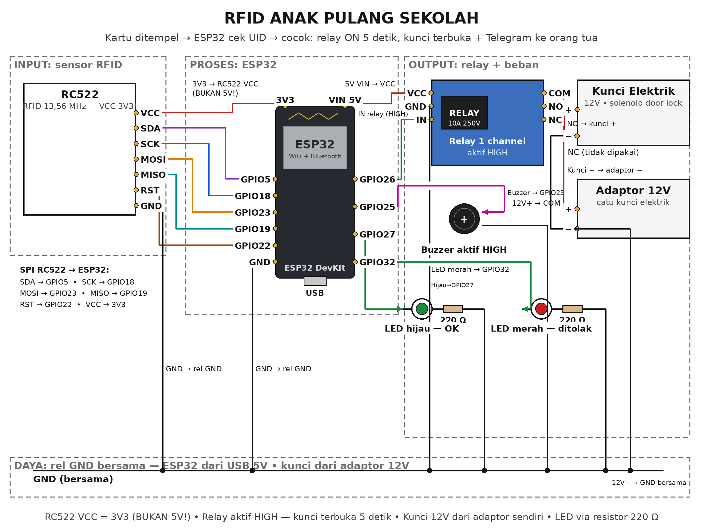

# RFID Anak Pulang Sekolah — ESP32 + RC522

Anak pulang sekolah, tapi kamu masih di kantor. Alat ini yang lapor: anak menempelkan kartu RFID ke modul RC522, kunci elektrik terbuka, dan HP orang tua langsung dapat notifikasi Telegram — "Alif sudah sampai rumah."

Kode dari YouTube Short **"RFID Anak Pulang Sekolah"**.

## Komponen

| Komponen | Keterangan |
|---|---|
| ESP32 DevKit | Board utama (WiFi built-in) |
| Modul RFID RC522 | Pembaca kartu 13,56 MHz (+ 1 kartu & 1 tag bawaan) |
| Kunci elektrik 12V | Solenoid door lock |
| Modul relay 5V, 1 channel | Menyalakan kunci 12V |
| Buzzer aktif 5V | Bunyi saat kartu ditolak |
| LED hijau + LED merah | Indikator akses OK / ditolak |
| Resistor 220 ohm (2x) | Untuk LED |

## Skema rangkaian



Arus kunci: 12V+ → COM relay → NO relay → Kunci (+) → Kunci (−) → GND 12V. GND 12V dan GND ESP32 disatukan.

## Wiring

| RC522 / komponen | Pin ESP32 |
|---|---|
| SDA (SS) | GPIO5 |
| SCK | GPIO18 |
| MOSI | GPIO23 |
| MISO | GPIO19 |
| RST | GPIO22 |
| VCC | 3V3 (**bukan 5V!** RC522 bisa rusak di 5V) |
| GND | GND |
| Relay IN | GPIO26 |
| Buzzer (+) | GPIO25, (−) GND |
| LED hijau | GPIO27 (lewat 220 ohm ke GND) |
| LED merah | GPIO32 (lewat 220 ohm ke GND) |
| Kunci 12V | Lewat kontak relay (NO + COM), catu 12V terpisah |

## Library yang dibutuhkan (Arduino IDE)

Buka **Sketch > Include Library > Manage Libraries**, lalu install:

| Library | Penulis | Versi |
|---|---|---|
| **MFRC522** | GithubCommunity | 1.4.10 |
| **UniversalTelegramBot** | Brian Lough | 1.3.0 |
| **ArduinoJson** | Benoit Blanchon | **6.21.x (versi 6, BUKAN 7)** |

> ⚠️ **Penting:** UniversalTelegramBot 1.3.0 hanya cocok dengan ArduinoJson **versi 6**. Kalau terlanjur install ArduinoJson 7, hapus dan install 6.21.5 — kalau tidak, compile akan gagal.
>
> Library lain (SPI, WiFi, WiFiClientSecure) sudah bawaan board ESP32, tidak perlu install.

Board yang dipakai: **esp32 by Espressif Systems** (install lewat Boards Manager, pilih board "ESP32 Dev Module").

Tidak mau pakai Telegram? Ubah `#define USE_TELEGRAM 1` menjadi `0` di atas file `RfidPulang.ino` — maka UniversalTelegramBot dan ArduinoJson tidak dibutuhkan, kunci tetap jalan dan laporan hanya lewat Serial Monitor.

## Cara compile & upload

1. Buka `RfidPulang/RfidPulang.ino` di Arduino IDE.
2. Isi bagian konfigurasi di atas file:
   - `WIFI_SSID` dan `WIFI_PASSWORD` — WiFi rumahmu.
   - `BOT_TOKEN` — buat bot di Telegram: chat **@BotFather** → `/newbot` → salin tokennya.
   - `CHAT_ID` — chat **@userinfobot** di Telegram, catat angka "Id" kamu.
3. Pilih board **ESP32 Dev Module**, pilih port USB yang benar.
4. Klik **Upload**.

## Daftarkan kartu (wajib sebelum dipakai)

1. Upload sketch apa adanya dulu, buka **Serial Monitor** (115200 baud).
2. Tempel kartu ke modul RC522 — UID kartu tercetak di Serial Monitor, misal `A1 B2 C3 D4`.
3. Isi UID itu ke daftar `KARTU_DIIZINKAN` di atas file, beserta namanya:
   ```cpp
   { "A1 B2 C3 D4", "Alif" },
   ```
4. Upload ulang. Kartu yang tidak ada di daftar akan ditolak: pintu tetap terkunci, buzzer berbunyi 3 kali, dan UID-nya tercetak di Serial Monitor supaya bisa didaftarkan.

## Cara kerja (logika inti)

```cpp
uid = bacaKartu();                 // dari modul RC522
nama = cariNama(uid);              // cocokkan dengan daftar
if (nama != nullptr) {
  bukaKunci(5 detik);              // relay ON + LED hijau
  kirimPesan(nama + " sudah sampai rumah.");
} else {
  tolakKartu();                    // buzzer 3x + LED merah
}
```

Notifikasi dikirim **sekali** per tempelan kartu (kartu yang sama diabaikan 10 detik supaya tidak spam). Kunci menutup sendiri setelah 5 detik.

## Video

- Short 60 detik: ide → konsep → desain → implementasi (lihat deskripsi video untuk link).
- Skema di atas juga tampil di dalam video.

## Lisensi

MIT — bebas dipakai, diubah, dan dibagikan, cantumkan sumber.
